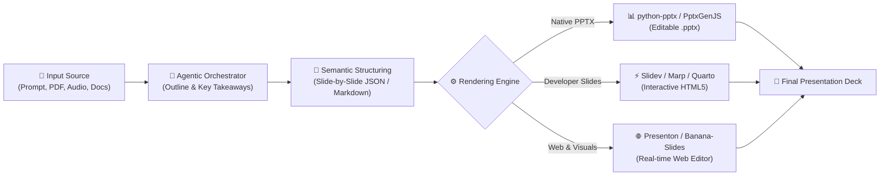

# 🚀 Awesome Presentation Generation & AI Slide Creation

  <strong>Curated Directory of SaaS Platforms, Open-Source Slide Engines, Agentic PPTX Pipelines &amp; Automated Visual Storytelling Tools</strong> 
  <em>Transform text prompts, research papers, Markdown notes, and raw documents into executive pitch decks, native PowerPoint (.pptx) files, and interactive web slide presentations.</em>

[🌐 SaaS Platforms](#-top-saas-platforms) • [⭐ Open-Source Projects](#-open-source-github-projects) • [📊 Sector Overview](#-sector-overview--market-dynamics) • [🤝 Contributing](#-how-to-contribute) • [📄 Disclaimer](#-disclaimer)

---

## 📌 Table of Contents

- [📈 Sector Overview & Market Dynamics](#-sector-overview--market-dynamics)
- [🌐 Top SaaS Platforms](#-top-saas-platforms)
- [⭐ Open-Source GitHub Projects](#-open-source-github-projects)
  - [🗂️ Open-Source Repositories (Ranked by Stars)](#-open-source-repositories-ranked-by-stars)
  - [🧩 Complementary Presentation Utilities & Frameworks](#-complementary-presentation-utilities--frameworks)
- [🎯 Key Architectural Workflows](#-key-architectural-workflows)
- [🤝 How to Contribute](#-how-to-contribute)
- [💖 Support](#-support)
- [📊 Star History](#-star-history)
- [📄 Disclaimer](#-disclaimer)

---

## 📈 Sector Overview & Market Dynamics

The global presentation software and AI slide creation market is valued at approximately **$6.2 billion to $8.6 billion**, projected to surpass **$22 billion by 2032** growing at a robust **CAGR of ~14.8%** driven by generative AI integrations, remote workplace collaboration, and enterprise workflow automation.

Market structure exhibits a **dual bifurcation**: the top enterprise tier is **highly consolidated** around bundled legacy office suites (Microsoft PowerPoint within Microsoft 365 and Google Slides within Google Workspace), whereas the modern AI presentation, pitch deck, and interactive visual layer is **moderately to highly fragmented**, characterized by intense competition among agile AI-native challengers (Canva, Gamma, Pitch, Beautiful.ai) alongside an exploding open-source ecosystem catering to programmatic and agentic document-to-deck workflows.

---

## 🌐 Top SaaS Platforms

The table below lists leading commercial presentation builders, prompt-to-deck engines, and AI slide platforms, sorted in descending order by enterprise scale (valuation or annualized revenue).

| 🏢 Platform | 💰 Scale (Valuation / Revenue) | 🏷️ Starting Paid Tier | 🎁 Free Tier Limits / Free Trial | 🔍 Core AI Capabilities & Description |
|:---|:---|:---|:---|:---|
| **[Canva Presentations](https://canva.com)** | **$42.0B Valuation** (~$3.5B ARR) | **$15.00/mo** ($120/yr Canva Pro) | **Free Plan**: 5GB cloud storage, thousands of templates, free Magic Design AI generations (subject to monthly fair-use limits) | Cloud visual design suite offering Magic Design text-to-presentation, Magic Write copilot, brand kits, instant translations, and export to `.pptx` and PDF. |
| **[Gamma App](https://gamma.app)** | **$2.1B Valuation** ($100M+ ARR) | **$10.00/user/mo** ($96/yr billed annually) | **Free Plan**: 400 one-time AI credits at signup (generates ~10 full decks), basic analytics, 7-day revision history, Gamma badge on shared links | AI-native presentation, doc, and webpage builder transforming single-line prompts, outlines, or pasted notes into interactive, responsive decks. |
| **[Tome](https://tome.app)** | **$300.0M Valuation** (Peak Series B) | **$16.00/user/mo** ($192/yr billed annually) | **Free Trial**: Limited sandbox access upon signup with starter AI credits; historical permanent free tier discontinued | Generative storytelling and sales deck platform combining text generation, dynamic card-based layouts, responsive styling, and multimedia embeds. |
| **[Pitch](https://pitch.com)** | **$137.0M Total Funding** | **$22.00/mo** for 2 members ($264/yr billed annually) | **Free Plan**: Up to 5 workspace members, unlimited presentations created forever, 100 one-time AI credits, Pitch branding on exports/links | Collaborative team presentation platform featuring AI deck generation, smart layout formatting, brand templates, live video, and slide analytics. |
| **[Slidesgo](https://slidesgo.com)** | **Freepik Sub.** (~$80M+ Parent Rev.) | **$4.99/mo** ($27.99/yr Premium) | **Free Plan**: 3 template downloads/month, up to 3 AI-generated presentations/month (attribution required on free downloads) | Massive catalog of customizable Google Slides and PowerPoint design templates paired with an automated AI slide outline and deck generator. |
| **[Prezi AI](https://prezi.com)** | **$45.0M Est. Revenue** ($72.8M Funding) | **$7.00/user/mo** ($84/yr Standard plan) | **Free Plan**: Up to 5 active presentation projects, 500 one-time AI credits, public presentation visibility, Prezi watermark | Zoomable canvas presentation platform featuring conversational AI outline structuring, spatial visual transitions, and dynamic smart charting. |
| **[Beautiful.ai](https://beautiful.ai)** | **$14.0M Est. ARR** ($61M Funding) | **$12.00/mo** ($144/yr Pro billed annually) | **14-Day Free Trial**: Full access to Pro/Team features (unlimited AI generation, export to PPTX); requires billing details, no permanent free tier | Cloud presentation software with Smart Slides and DesignerBot that adapt slide layouts, margins, typography, and corporate branding dynamically. |
| **[SlidesAI](https://slidesai.io)** | **$3.5M Est. ARR** (Bootstrapped) | **$10.00/mo** ($100/yr Pro plan) | **Free Plan**: 200 AI credits per month, presentations capped at 10 slides, topic/text prompt input only (no PDF upload), 1 Brand Kit | AI add-on extension for Google Slides and Microsoft PowerPoint that summarizes long text, transcripts, and notes into structured multi-slide decks. |
| **[Decktopus](https://decktopus.com)** | **$2.9M Est. ARR** | **$14.99/user/mo** ($179.88/yr Pro plan) | **Free Signup Pool**: One-time initial credit allocation to generate 1 test presentation (up to 3 slides) with watermarks; export locked | Automated presentation builder generating slide outlines, speaker notes, talking points, form embeds, and visual layouts from conversational topic prompts. |
| **[Storydoc](https://storydoc.com)** | **$2.0M Est. ARR** ($430K Seed) | **$30.00/user/mo** ($360/yr Starter plan) | **14-Day Free Trial**: Full access to interactive proposal, one-pager, and pitch deck templates and analytics; no permanent free tier | Interactive, web-based pitch deck, proposal, and case-study generator replacing static PDFs with scrollable, interactive, analytics-tracked decks. |

---

## ⭐ Open-Source GitHub Projects

An exhaustive directory of open-source AI presentation generators, programmable slide engines, agentic PPTX frameworks, and Markdown presentation compilers.

### 🗂️ Open-Source Repositories (Ranked by Stars)

The following repositories are strictly sorted in descending order by GitHub Stars_Count. Each entry features a social Stars_Badge linking directly to that project's stargazers community.

| 📦 Repository & Link | ⭐ Stargazers | 💻 Primary Stack | 📝 Description & Architectural Role |
|:---|:---|:---|:---|
| **[hakimel/reveal.js](https://github.com/hakimel/reveal.js)** |  | JavaScript / HTML5 | Foundational HTML5/CSS presentation framework widely targeted by LLM agents to render animated, interactive slide decks in web browsers. |
| **[slidevjs/slidev](https://github.com/slidevjs/slidev)** |  | Vue 3 / Vite / TypeScript | Developer-first Markdown presentation engine featuring interactive Vue components, LaTeX math formulas, live code runners, and presentation recording. |
| **[jgm/pandoc](https://github.com/jgm/pandoc)** |  | Haskell / C | Universal document converter utilized in agentic presentation pipelines to translate LLM-generated Markdown into native `.pptx`, Beamer, and Reveal.js decks. |
| **[danielmiessler/fabric](https://github.com/danielmiessler/fabric)** |  | Go / Python / Shell | Modular AI framework and prompt architecture featuring dedicated patterns (`create_keynote`, `to_flashcards`) to extract slide outlines from transcripts. |
| **[Anionex/banana-slides](https://github.com/Anionex/banana-slides)** |  | TypeScript / Python | AI-native slide generator based on multimodal LLMs; parses reference template images, supports document upload, voice edits, and export to editable `.pptx`. |
| **[gnab/remark](https://github.com/gnab/remark)** |  | JavaScript | In-browser Markdown slideshow tool driven entirely by HTML and CSS; lightweight target for quick prompt-to-HTML slideshow rendering. |
| **[marp-team/marp](https://github.com/marp-team/marp)** |  | TypeScript / Node.js | Deterministic Markdown-to-presentation ecosystem (Marpit + Marp CLI) favored by autonomous agents for reliable PDF and PPTX slide rendering. |
| **[presenton/presenton](https://github.com/presenton/presenton)** |  | TypeScript / Python / React | Complete open-source self-hosted AI presentation generator and API (Gamma/Beautiful.ai alternative) supporting OpenAI, Gemini, Ollama, and `.pptx` export. |
| **[FormidableLabs/spectacle](https://github.com/FormidableLabs/spectacle)** |  | React / TypeScript | Modern ReactJS-based presentation library allowing developers and generative pipelines to author decks as interactive JSX components. |
| **[gitbrent/PptxGenJS](https://github.com/gitbrent/PptxGenJS)** |  | JavaScript / TypeScript | Client and server JavaScript library for programmatically generating native Microsoft PowerPoint (`.pptx`) decks with complex shapes, tables, and media. |
| **[quarto-dev/quarto-cli](https://github.com/quarto-dev/quarto-cli)** |  | TypeScript / Python / R | Open-source scientific and technical publishing system compiling computational Markdown (Python/R/Julia) into Reveal.js, Beamer, and PowerPoint. |
| **[hiroppy/fusuma](https://github.com/hiroppy/fusuma)** |  | JavaScript / Webpack | Tool to create browser-friendly slides from Markdown with zero-configuration, SEO support, responsive layouts, and live code highlighting. |
| **[scanny/python-pptx](https://github.com/scanny/python-pptx)** |  | Python | The de-facto Python library for creating and styling native `.pptx` presentations; core backend engine used by Python-based AI slide creation agents. |
| **[allweonedev/presentation-ai](https://github.com/allweonedev/presentation-ai)** |  | TypeScript / Next.js | Open-source web AI presentation generator and Gamma alternative for generating structured slides with theme customization and AI copy. |
| **[astefanutti/decktape](https://github.com/astefanutti/decktape)** |  | JavaScript / Puppeteer | High-fidelity PDF exporter for HTML5 slide decks (supports Reveal.js, Slidev, Remark, Impress.js, and Marp). |
| **[LearnPrompt/humanize-ppt](https://github.com/LearnPrompt/humanize-ppt)** |  | Python / TypeScript | AST-based outline director and layout orchestrator designed for human-centered generative AI presentation workflows. |
| **[Faust-Donf/beamer-academic](https://github.com/Faust-Donf/beamer-academic)** |  | Python / TeX | Automated pipeline converting academic research papers and theses directly into LaTeX Beamer defense slide decks using Claude and LLM skills. |
| **[LangChat/langchat-slides](https://github.com/LangChat/langchat-slides)** |  | Vue 3 / JavaScript | Next-generation AI PPT application based on Vue 3 with automated section generation, rich visual layouts, and template management. |

---

### 🧩 Complementary Presentation Utilities & Frameworks

Pair these foundational tools with the repositories above to construct private, air-gapped, or highly automated slide generation pipelines:

- 🦙 **[Ollama](https://github.com/ollama/ollama)** & ⚡ **[LiteLLM](https://github.com/BerriAI/litellm)**: Host and orchestrate local open-weights LLMs (Llama 3, DeepSeek-V3, Qwen 2.5) as drop-in OpenAI-compatible inference endpoints with zero recurring cloud API fees.
- 🎨 **[Excalidraw](https://github.com/excalidraw/excalidraw)** & 📊 **[Mermaid.js](https://github.com/mermaid-js/mermaid)**: Programmatic diagramming engines enabling AI agents to generate architectural schematics, sequence flows, and mind maps directly inside slides.
- 📐 **[Typst](https://github.com/typst/typst)** & **[Touying](https://github.com/touying-typst/touying)**: Modern, ultra-fast markup typesetting system offering programmable, type-safe slide deck creation for academic, math, and engineering presentations.
- 🖥️ **[LibreOffice Impress Headless](https://github.com/LibreOffice/core)**: Automated server-side conversion pipeline for rendering `.pptx` decks into PDFs and PNG thumbnails.

---

## 🎯 Key Architectural Workflows

How modern AI presentation systems operate under the hood:

1. **Document Ingestion**: Parsing long-form PDFs, transcripts, or user prompts into structured knowledge chunks.
2. **Slide-Level Storyboarding**: Prompting an LLM to generate title, bullet points, layout hints, and speaker notes per slide.
3. **Format Synthesis**:
   - Programmatic generation using **`python-pptx`** or **`PptxGenJS`** for native `.pptx` export.
   - Markdown generation compiled deterministically via **Marp**, **Slidev**, or **Pandoc**.
4. **Visual Enhancement**: Dynamic asset embedding via Unsplash APIs, ComfyUI/Stable Diffusion image generation, or Mermaid diagrams.

---

## 🤝 How to Contribute

We welcome contributions from developers, researchers, designers, and founders! To submit a new SaaS platform or open-source tool:

1. **Fork** this repository.
2. Add your entry to either the **SaaS Table** or **Open-Source Table** ensuring proper sorting:
   - SaaS entries: Include exact pricing, free tier/trial details, and company valuation/revenue metrics.
   - Open-Source entries: Include GitHub link, social Stars_Badge `https://img.shields.io/github/stars/{owner}/{repo}?style=social&color=white` linking to `/stargazers`, and primary stack.
3. Ensure formatting and links adhere to GFM standards.
4. Submit a **Pull Request** detailing why the tool is valuable to the AI presentation ecosystem.

⭐ **Star this repository** if you find this ecosystem index helpful!

---

## 💖 Support

A huge thank you to everyone exploring, using, and contributing to this ecosystem! If you find this curated directory helpful for your research, projects, or workflow:

- ⭐ **Star** this repository to help others discover it.
- 🍴 **Fork** it to build your own custom slide generators or workflows.
- 📢 **Share** it with fellow AI engineers, founders, researchers, and creators.
- ☕ **Buy me a coffee / Sponsor**: If you'd like to support ongoing maintenance and new tools indexing, please consider sponsoring via the **[GitHub Sponsors Dashboard](https://github.com/sponsors/ishandutta2007)**!

---

## 📊 Star History

---

## 📄 Disclaimer

- This repository is a community-maintained research index and does not represent commercial endorsement or sponsorship.
- LLM presentation generators can occasionally hallucinate statistics, misalign visual layouts, or misinterpret technical diagrams. Always verify factual claims and corporate slide branding before public presentation.
- When generating presentations using internal or confidential company documents, ensure your AI workflows utilize private, zero-retention, or self-hosted LLM endpoints.

---

  Curated with ❤️ by <a href="https://github.com/ishandutta2007">Ishan Dutta</a> and the open-source AI community.

